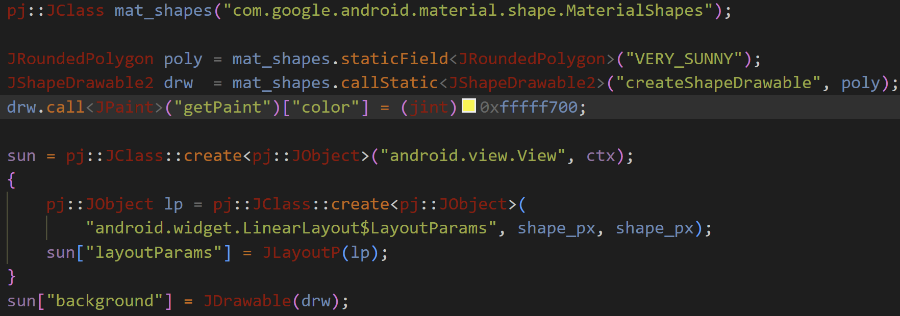

# RegEx Color Panel

Inline color swatches and a native VS Code color picker for **configurable color formats** — including hex, decimal, float, and percentage channels, with full control over channel order. Configure the regex pattern, channel order (ARGB, RGBA, BGR, RGB, …), and output template independently per language.



## Features

- Inline color swatches next to every matched literal
- Click the swatch to open the VS Code native color picker
- Editing the color writes back the literal in its original format (case-preserved)
- Percentage alpha read/write in comma-separated `rgba()` and space-separated `rgb(R G B / A%)`
- Resolve simple CSS `var()` channel references in the current document; picking a color updates their definitions and preserves the references
- Fully configurable: regex pattern, channel byte order, output template, per-language scope
- Ships with defaults for `0x` ARGB 32-bit, `0x` RGB 24-bit, CSS `#RRGGBBAA`, CSS `rgb()` / `rgba()`, Win32 BGR COLORREF, and GLSL packed RGBA

## Settings: enable the new formats

### Recommended: use the built-in defaults

Open **Preferences: Open User Settings (JSON)**. Remove the old `regexColorPanel.formats` property and its entire array, then keep:

```json
{
  "editor.colorDecorators": true
}
```

Merge this property into your existing settings object. Do not replace unrelated settings. The new defaults already include percentage alpha, decimal alpha, modern `rgb(R G B / A)`, and same-document CSS variable support; no custom `formats` array is required.

**`regexColorPanel.formats` replaces the entire default array. It does not append to it.** An old array containing only a `CSS RGB channels` rule enables only bare values such as `37 99 235`; it does not enable `rgb(37 99 235 / 10%)`. Remove any such override from User, Remote, Workspace, and language-specific settings (for example `[css]`) that apply to the document. Setting `formats` to `[]` disables this extension's formats instead of restoring the defaults.

`color-highlight.enableColorPicker: false` is an optional setting for the separate Color Highlight extension, if installed. RegEx Color Panel does not require it.

### Explicit CSS configuration (optional, ready to paste)

If you prefer to configure the rules yourself, use the following complete JSON settings object. It enables the listed CSS formats and replaces all other built-in formats. Merge the properties into your existing settings object, replacing the old `regexColorPanel.formats` array completely.

```json
{
  "editor.colorDecorators": true,
  "regexColorPanel.formats": [
    {
      "name": "CSS rgb(r g b / a%)",
      "pattern": "\\brgba?\\(\\s*(\\d{1,3})\\s+(\\d{1,3})\\s+(\\d{1,3})\\s*/\\s*(\\d*\\.?\\d+)\\s*%\\s*\\)",
      "channels": "RGBA",
      "channelTypes": "dddp",
      "template": "rgb({Rd} {Gd} {Bd} / {Ap}%)",
      "resolveCssVariables": true,
      "languages": ["css", "scss", "less", "html", "javascript", "typescript", "javascriptreact", "typescriptreact"]
    },
    {
      "name": "CSS rgb(r g b / a)",
      "pattern": "\\brgba?\\(\\s*(\\d{1,3})\\s+(\\d{1,3})\\s+(\\d{1,3})\\s*/\\s*(\\d*\\.?\\d+)\\s*\\)",
      "channels": "RGBA",
      "channelTypes": "dddf",
      "template": "rgb({Rd} {Gd} {Bd} / {Af})",
      "resolveCssVariables": true,
      "languages": ["css", "scss", "less", "html", "javascript", "typescript", "javascriptreact", "typescriptreact"]
    },
    {
      "name": "CSS rgba(r, g, b, a%)",
      "pattern": "rgba\\(\\s*(\\d{1,3})\\s*,\\s*(\\d{1,3})\\s*,\\s*(\\d{1,3})\\s*,\\s*(\\d*\\.?\\d+)\\s*%\\s*\\)",
      "channels": "RGBA",
      "channelTypes": "dddp",
      "template": "rgba({Rd}, {Gd}, {Bd}, {Ap}%)",
      "languages": ["css", "scss", "less", "html", "javascript", "typescript", "javascriptreact", "typescriptreact"]
    },
    {
      "name": "CSS rgba(r, g, b, a)",
      "pattern": "rgba\\(\\s*(\\d{1,3})\\s*,\\s*(\\d{1,3})\\s*,\\s*(\\d{1,3})\\s*,\\s*(\\d*\\.?\\d+)\\s*\\)",
      "channels": "RGBA",
      "channelTypes": "dddf",
      "template": "rgba({Rd}, {Gd}, {Bd}, {Af})",
      "languages": ["css", "scss", "less", "html", "javascript", "typescript", "javascriptreact", "typescriptreact"]
    },
    {
      "name": "CSS rgb(r, g, b)",
      "pattern": "rgb\\(\\s*(\\d{1,3})\\s*,\\s*(\\d{1,3})\\s*,\\s*(\\d{1,3})\\s*\\)",
      "channels": "RGB",
      "channelTypes": "ddd",
      "template": "rgb({Rd}, {Gd}, {Bd})",
      "languages": ["css", "scss", "less", "html", "javascript", "typescript", "javascriptreact", "typescriptreact"]
    },
    {
      "name": "CSS / HTML RGBA 32-bit (#RRGGBBAA)",
      "pattern": "#([0-9a-fA-F]{2})([0-9a-fA-F]{2})([0-9a-fA-F]{2})([0-9a-fA-F]{2})(?![0-9a-fA-F])",
      "channels": "RGBA",
      "template": "#{R}{G}{B}{A}",
      "languages": []
    }
  ]
}
```

The two space-separated rules enable `resolveCssVariables`. They can read `rgb(var(--inset-border-rgb) / var(--inset-border-opacity))` when both variables have unique, direct numeric definitions in the same document. Picking a color updates the definitions while keeping the `var()` references; changing a referenced alpha writes its definition as a percentage. Unresolved or ambiguous references are skipped.

For percentage literals, the fourth channel must use `p` (`"channelTypes": "dddp"`) and the template must contain `{Ap}%`. The `%` is literal text in both the pattern and template. The `f` / `{Af}` rules intentionally preserve decimal alpha. For packed hex RGB with a separate percentage alpha, see [Hex RGB with separate percentage alpha](#hex-rgb-with-separate-percentage-alpha-custom-format).

### Check percentage writeback

Start with `color: rgb(37 99 235 / 10%);`, open its color picker, and change alpha to 25%. The result should be `color: rgb(37 99 235 / 25%);`. If a previous test already changed the literal to `rgba(..., 0.123)`, restore a percentage literal before retesting: a decimal input matches the decimal rule and remains decimal.

Earlier builds could let VS Code's built-in CSS provider take ownership of the same color range, even with the correct format settings. This version registers a wildcard selector so the format-preserving result comes before built-in CSS presentations. Built-in CSS language features can stay enabled. After updating the source, restart F5 or run **Developer: Reload Window** in the development window.

If the picker still writes `rgba(..., 0.25)`, check the effective `regexColorPanel.formats` setting in that window and put a breakpoint in this extension's `provideColorPresentations`. A color swatch alone does not prove this extension is handling the edit: VS Code or another extension may also provide a color picker. When testing via F5, check settings in the **Extension Development Host** window, which inherits User/Remote settings but opens the separate `examples/` workspace.

## Default formats

| Name | Pattern example | Byte order | Languages |
|---|---|---|---|
| ARGB 32-bit | `0xFF1A237E` | ARGB | c, cpp, java, kotlin, objc, swift |
| RGB 24-bit | `0x1A237E` | RGB | c, cpp, java, kotlin, objc, swift |
| CSS/HTML RGBA 32-bit | `#1A237EFF` | RGBA | all |
| CSS rgb(r, g, b) | `rgb(26, 35, 126)` | RGB (decimal) | css, scss, less, html, js, ts |
| CSS rgba(r, g, b, a) | `rgba(26, 35, 126, 1.0)` | RGBA (decimal + float alpha) | css, scss, less, html, js, ts |
| CSS rgba(r, g, b, a%) | `rgba(26, 35, 126, 75%)` | RGBA (decimal + percentage alpha) | css, scss, less, html, js, ts |
| CSS rgb(r g b / a) | `rgb(37 99 235 / 0.1)` | RGBA (decimal + float alpha) | css, scss, less, html, js, ts |
| CSS rgb(r g b / a%) | `rgb(37 99 235 / 10%)` | RGBA (decimal + percentage alpha) | css, scss, less, html, js, ts |
| Win32 BGR COLORREF | `0x007E231A` | BGR | c, cpp |
| GLSL packed RGBA | `0x1A237EFFu` | RGBA | glsl, cpp |

## Customizing formats (`regexColorPanel.formats`)

Each entry in the `regexColorPanel.formats` array describes one pattern. This setting replaces the defaults; include every format you want to recognize, or remove the setting to restore the defaults.

| Field | Required | Description |
|---|---|---|
| `name` | no | Human-readable label (ignored at runtime, shown in IntelliSense) |
| `pattern` | **yes** | JavaScript regex string. Each capture group captures one channel value. |
| `channels` | **yes** | String mapping capture groups (left to right) to channels: letters `A`, `R`, `G`, `B`. Missing channels default to `255`. |
| `channelTypes` | no | String, same length as `channels`. Each char sets the value type per group: `h` = hex 2-digit (default), `d` = decimal 0–255, `f` = float 0.0–1.0, `p` = percentage 0–100. For `p`, capture the number without `%`. Omit to treat all groups as hex. |
| `template` | **yes** | Output template. `{X}` or `{Xh}` = hex, `{Xd}` = decimal, `{Xf}` = float, `{Xp}` = percentage (0–100, up to three decimal places) — where X is `A`, `R`, `G`, or `B`. E.g. `0x{A}{R}{G}{B}`, `rgb({Rd}, {Gd}, {Bd})`. |
| `resolveCssVariables` | no | Enable simple `var()` references in space-separated CSS `rgb()` / `rgba()` with slash alpha. Only unique numeric definitions in the current document are editable. Enabled for the two modern CSS defaults. |
| `languages` | no | Array of VS Code language IDs to restrict this format to. Empty array or omitted = all languages. |

### How pattern + channels work

The regex captures one pair of hex digits per channel. The `channels` string assigns a meaning to each capture group positionally:

```
pattern:  "0x([0-9a-fA-F]{2})([0-9a-fA-F]{2})([0-9a-fA-F]{2})([0-9a-fA-F]{2})"
           group 1 ──────────┘ group 2 ────────┘ group 3 ────────┘ group 4 ────────┘
channels: "ARGB"
           A ─────────────────┘ R ──────────────┘ G ──────────────┘ B ──────────────┘
```

When the user picks a new color, the token values are substituted into the template:

```
template: "0x{A}{R}{G}{B}"   →   "0xFF3F51B5"
```

Case is auto-preserved: if the original literal was all-uppercase the output is uppercase; if exclusively lowercase, lowercase.

---

## Examples

### ARGB 32-bit (default)

```jsonc
// .vscode/settings.json
{
  "regexColorPanel.formats": [
    {
      "name": "ARGB 32-bit",
      "pattern": "0x([0-9a-fA-F]{2})([0-9a-fA-F]{2})([0-9a-fA-F]{2})([0-9a-fA-F]{2})",
      "channels": "ARGB",
      "template": "0x{A}{R}{G}{B}",
      "languages": ["c", "cpp", "java", "kotlin", "objc", "swift"]
    }
  ]
}
```

Matches: `0xFF1A237E` → A=FF R=1A G=23 B=7E

---

### CSS/HTML RGBA 32-bit (default)

```jsonc
{
  "name": "CSS RGBA",
  "pattern": "#([0-9a-fA-F]{2})([0-9a-fA-F]{2})([0-9a-fA-F]{2})([0-9a-fA-F]{2})(?![0-9a-fA-F])",
  "channels": "RGBA",
  "template": "#{R}{G}{B}{A}",
  "languages": []
}
```

Matches: `#1A237EFF` → R=1A G=23 B=7E A=FF

---

### OpenGL / GLSL — RGBA floats packed as hex

```jsonc
{
  "name": "GLSL packed RGBA",
  "pattern": "0x([0-9a-fA-F]{2})([0-9a-fA-F]{2})([0-9a-fA-F]{2})([0-9a-fA-F]{2})u",
  "channels": "RGBA",
  "template": "0x{R}{G}{B}{A}u",
  "languages": ["glsl", "cpp"]
}
```

Matches: `0x1A237EFFu`

---

### CSS `rgb(r, g, b)` (default)

```jsonc
{
  "name": "CSS rgb(r, g, b)",
  "pattern": "rgb\\(\\s*(\\d{1,3})\\s*,\\s*(\\d{1,3})\\s*,\\s*(\\d{1,3})\\s*\\)",
  "channels": "RGB",
  "channelTypes": "ddd",
  "template": "rgb({Rd}, {Gd}, {Bd})",
  "languages": ["css", "scss", "less", "html", "javascript", "typescript"]
}
```

Matches: `rgb(26, 35, 126)` → R=26 G=35 B=126

---

### CSS `rgba(r, g, b, a)` (default)

```jsonc
{
  "name": "CSS rgba(r, g, b, a)",
  "pattern": "rgba\\(\\s*(\\d{1,3})\\s*,\\s*(\\d{1,3})\\s*,\\s*(\\d{1,3})\\s*,\\s*(\\d*\\.?\\d+)\\s*\\)",
  "channels": "RGBA",
  "channelTypes": "dddf",
  "template": "rgba({Rd}, {Gd}, {Bd}, {Af})",
  "languages": ["css", "scss", "less", "html", "javascript", "typescript"]
}
```

Matches: `rgba(26, 35, 126, 0.75)` → R=26 G=35 B=126 A=75%

---

### Percentage alpha (default)

`p` reads a percentage channel and `{Ap}` writes its numeric value. Add `%` literally in the pattern and template when the format uses it. For example, alpha `0.1` in the color picker writes `10%`, and `12.345%` round-trips without being rounded to an 8-bit alpha first. Existing `f` / `{Af}` formats continue to use 0–1 values.

```jsonc
{
  "name": "CSS rgb(r g b / a%)",
  "pattern": "\\brgba?\\(\\s*(\\d{1,3})\\s+(\\d{1,3})\\s+(\\d{1,3})\\s*/\\s*(\\d*\\.?\\d+)\\s*%\\s*\\)",
  "channels": "RGBA",
  "channelTypes": "dddp",
  "template": "rgb({Rd} {Gd} {Bd} / {Ap}%)",
  "resolveCssVariables": true,
  "languages": ["css", "scss", "less", "html", "javascript", "typescript"]
}
```

Matches `--control-focus-shadow: 0 0 0 3px rgb(37 99 235 / 10%)` and writes back `rgb(37 99 235 / 25%)` when alpha is changed to 25%. The default comma-separated format also supports `rgba(37, 99, 235, 10%)`.

### CSS variables in RGB and alpha

The modern CSS defaults also recognize simple variable references when their definitions are in the **same document**:

```css
:root {
  --inset-border-rgb: 37 99 235;
  --inset-border-opacity: 0.1;
}
.panel {
  border-color: rgb(var(--inset-border-rgb) / var(--inset-border-opacity));
}
```

Changing alpha to 25% updates `--inset-border-opacity: 25%;`; changing RGB updates `--inset-border-rgb`. The `rgb(var(...) / var(...))` expression remains intact, and unchanged channel definitions are left alone. Mixed literal/variable forms such as `rgb(37 99 235 / var(--inset-border-opacity))` also work.

Definitions must be unique and contain direct numeric values. Missing, duplicate, indirect, or external definitions, and `var()` fallbacks, are skipped. The extension does not infer selector cascade or import external stylesheets. If you override `regexColorPanel.formats`, include the applicable modern CSS entries and set `resolveCssVariables` to `true` to retain variable support.

### Hex RGB with separate percentage alpha (custom format)

Percentage channels also work alongside packed hexadecimal RGB. Capture each RGB byte separately, and use `p` for the alpha group:

```jsonc
{
  "name": "Hex RGB + percentage alpha",
  "pattern": "#([0-9a-fA-F]{2})([0-9a-fA-F]{2})([0-9a-fA-F]{2})\\s+(\\d*\\.?\\d+)%",
  "channels": "RGBA",
  "channelTypes": "hhhp",
  "template": "#{R}{G}{B} {Ap}%"
}
```

Matches `#2563EB 10%` and can write `#2563EB 25%`. For formats that store 0–100 without a percent sign, omit `%` from both the pattern and template.

---

### GLSL `vec4` — float components

```jsonc
{
  "name": "GLSL vec4 float",
  "pattern": "vec4\\(\\s*([\\d.]+)\\s*,\\s*([\\d.]+)\\s*,\\s*([\\d.]+)\\s*,\\s*([\\d.]+)\\s*\\)",
  "channels": "RGBA",
  "channelTypes": "ffff",
  "template": "vec4({Rf}, {Gf}, {Bf}, {Af})",
  "languages": ["glsl", "hlsl"]
}
```

Matches: `vec4(0.102, 0.137, 0.494, 1.0)` → full RGBA from floats

---

### Windows COLORREF — `0x00BBGGRR` (BGR byte order)

```jsonc
{
  "name": "Win32 COLORREF BGR",
  "pattern": "0x00([0-9a-fA-F]{2})([0-9a-fA-F]{2})([0-9a-fA-F]{2})",
  "channels": "BGR",
  "template": "0x00{B}{G}{R}",
  "languages": ["c", "cpp"]
}
```

Matches: `0x007E231A` → B=7E G=23 R=1A (displayed as #1A237E)

---

### Uppercase-prefixed constants — `COLOR_PRIMARY = 0XFF…`

The pattern is case-insensitive by default (`gi` flag is always applied), so `0X` and `0x` both match without any change to the pattern.

---

### Restricting a format to specific file types

Use the `languages` array with [VS Code language identifiers](https://code.visualstudio.com/docs/languages/identifiers):

```jsonc
{
  "name": "CSS only",
  "pattern": "#([0-9a-fA-F]{2})([0-9a-fA-F]{2})([0-9a-fA-F]{2})(?![0-9a-fA-F])",
  "channels": "RGB",
  "template": "#{R}{G}{B}",
  "languages": ["css", "scss", "less", "html"]
}
```

Omit `languages` (or set it to `[]`) to match in every file type.

---

### Combining multiple formats

`regexColorPanel.formats` is an array — list all the formats you need. When two patterns match at the same position, the **longer match wins**. When they start at the same position with the same length, the **first** entry in the array wins.

```jsonc
{
  "regexColorPanel.formats": [
    { "name": "ARGB 32-bit", "pattern": "0x([0-9a-fA-F]{2})([0-9a-fA-F]{2})([0-9a-fA-F]{2})([0-9a-fA-F]{2})", "channels": "ARGB", "template": "0x{A}{R}{G}{B}", "languages": ["cpp"] },
    { "name": "RGB 24-bit",  "pattern": "0x([0-9a-fA-F]{2})([0-9a-fA-F]{2})([0-9a-fA-F]{2})(?![0-9a-fA-F])",  "channels": "RGB",  "template": "0x{R}{G}{B}",     "languages": ["cpp"] }
  ]
}
```

The 8-digit ARGB entry is longer than the 6-digit RGB entry, so `0xFF1A237E` is always recognised as ARGB, not as RGB `0xFF1A23` followed by `7E`.

## Run and debug locally

1. Open the **repository root** in VS Code (the folder containing `regex-color-panel/` and `.vscode/`).
2. Select **Run RegEx Color Panel** in Run and Debug, then press **F5**.
3. In the new **Extension Development Host** window, open `alpha.css` if it is not already open. Hover a color swatch to open the picker.

The launch configuration loads `regex-color-panel/extension.js` directly and opens the `examples/` folder. This is a plain JavaScript extension with no build step or npm dependencies, so no `tasks.json`, `npm install`, or VSIX packaging is needed for debugging. The checked-in VSIX predates these source changes; F5 runs the working-tree source instead.

The manual launch configuration requests that installed extensions be disabled. Built-in CSS language features remain enabled so you can verify that the custom format wins when both providers recognize a color. The window still inherits User/Remote settings. Follow [Settings: enable the new formats](#settings-enable-the-new-formats) in the debug window to clear old format overrides, and use the breakpoint below to confirm which provider handles an edit.

`examples/alpha.css` includes expected results for percentage alpha, fractional percentages, decimal alpha, hex RGBA, variable-definition edits, and missing/ambiguous definitions. Undo changes between cases. For the custom packed-hex RGB plus separate percentage alpha format, add the configuration from the example above and test `#2563EB 10%` → `#2563EB 25%`.

To verify that this extension handles an edit, put a breakpoint inside `provideColorPresentations` in `extension.js`, then change a color in the debug window. Source edits take effect after running **Developer: Reload Window** in that window (or restarting F5).

### Integration check with the built-in CSS provider

Select **Test RegEx Color Panel (with built-in CSS)** in Run and Debug and press F5. This runs `test/color-provider.integration.js` inside a real extension host, explicitly activates the built-in CSS extension, and checks that custom percentage, decimal, and hex presentations come first. It also applies variable-definition edits and verifies that the `var()` references remain unchanged. No test dependencies or build task are required. The Debug Console prints `PASS: 5 real extension-host checks with the built-in CSS provider active.` on success.

## Requirements

VS Code 1.75 or later. No other dependencies.

## License

MIT
